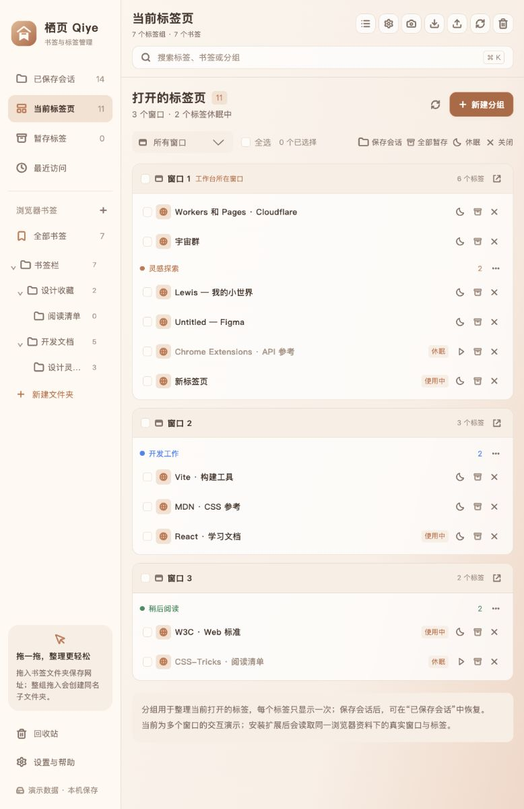

<p align="center">
  
</p>

# Qiye

[简体中文](README.md) | **English**

**Organize tabs across windows into sessions you can return to.**

Qiye is a local-first workspace for browser tabs and bookmarks. Manage open tabs, native tab groups, saved sessions, and browser bookmarks in one place, with drag-and-drop organization and a stash for links you want to revisit.

Current version: **v1.5.1** · Manifest V3 · Simplified Chinese / English · No third-party runtime dependencies

[Download latest](https://github.com/wang-zhengxin/qiye/releases/latest) · [Features](#features) · [Browser support](#browser-support) · [Install and run](#install-and-run) · [Usage guide](#usage-guide) · [FAQ](#faq)

<details>
<summary>View the workspace preview (demo data)</summary>



The screenshot shows the Chinese interface with demo tabs from three windows. The web preview uses separate data and cannot read or close your real browser tabs. An English interface is also available.

</details>

## Features

- **Multi-window tab management**: See all open windows in the current browser profile by default, organized by window and native group. Select tabs by window, focus a window, activate a tab, and receive live updates.
- **Native tab groups**: Group selected tabs, drag tabs into an existing browser group, or save, sleep, close, and ungroup its members.
- **Saved sessions**: Keep sets of URLs for later. Rename, star, lock, clone, deduplicate, and sort sessions, then reopen their links together.
- **Browser bookmarks**: Work directly with native bookmarks and folders. Add and edit links, create nested folders, move items by dragging, and restore items deleted through Qiye. Built-in and managed folders are protected.
- **Tab sleep and stash**: Unload background tabs to release memory while keeping them in the tab strip, or stash their URLs for later organization.
- **Search and backups**: Search tabs, sessions, stashed links, and bookmarks. Import and export collections, create workspace snapshots, and recover deleted saved items from the recycle bin.
- **Pane sizes and custom names**: Drag navigation, content and side-card edges to resize them. Sizes are retained locally. Set a Qiye display name for open tabs, rename saved tabs and native groups, and scroll long lists independently without losing your position when selecting tabs.
- **Configurable workspace**: 77 preferences across 9 sections cover saving and opening behavior, appearance, title cleanup, context menus, the popup, the new-tab page, and search.
- **Optional remote sync**: Connect your own WebDAV server or GitHub Secret Gist to sync sessions, stashed links, and optional preferences, manually or on a schedule.

Drag a separator to resize a pane. Double-click it or press Home to reset that dimension; use the top-bar reset control to restore all sizes. Focus a separator and use arrow keys to adjust it, holding Shift for larger steps. Narrow screens use a single column and hide width controls.

Renaming an open tab changes its Qiye display name only, without modifying the page or browser tab-strip title. Tabs with the same full URL share the name; leave it blank to restore the page title. These names and pane sizes stay in local browser storage and are excluded from remote preference sync. Saving a tab to a session or bookmark retains its current display name.

### How the different types of content work

| Content | Purpose and behavior |
| --- | --- |
| Open tabs | Pages actually open in your browser, organized by window. Closing a tab closes that page. |
| Native tab groups | The browser's way of organizing open tabs. Each member appears once in the open-tab list. |
| Saved sessions | Stored sets of URLs that can be reopened later, independently of the tabs currently open. |
| Browser bookmarks | Your browser's own bookmarks and folders. Changes apply directly to the native data. |
| Stashed tabs | Saved links waiting to be organized into a session or bookmark folder. |

The Open tabs page uses a single full-width list. Session and bookmark views can show an auxiliary open-tab panel on the right for dragging links into collections. You can hide this panel in preferences.

## Browser support

Qiye targets **desktop browsers**, with separate builds where needed.

| Browser | Requirements | Build directory | Current support |
| --- | --- | --- | --- |
| Chrome / Edge / Brave / Opera / Vivaldi | Chromium engine 120+ | `dist/` | Multi-window tabs, saved sessions, and native bookmarks. Native groups and tab sleep depend on the APIs available in the browser. |
| Firefox | 140+ | `dist-firefox/` | Multi-window tabs, saved sessions, native bookmarks, native groups, and tab sleep. The current build is unsigned and intended for temporary testing. |
| Safari on macOS | Safari 18+ recommended; full Xcode for local conversion | `dist-safari/` | Conversion source and capability fallbacks only; no installable app is available yet. Native bookmarks, native groups, and tab sleep are unavailable. |

Unavailable features are disabled with an explanation. API simulations and build checks are covered, but the extension has not been installed and tested in every browser listed above. See [browser support and validation scope](BROWSERS.md) (Chinese) for details and official references.

## Install and run

### Download a prebuilt version

Download the appropriate asset from [GitHub Releases](https://github.com/wang-zhengxin/qiye/releases/latest). Node.js is not required for prebuilt packages:

- **Chromium ZIP**: for Chrome / Edge / Brave / Opera / Vivaldi. Extract it, then choose **Load unpacked** on the browser's extension management page.
- **Firefox ZIP**: an unsigned temporary test build. Extract it and temporarily load `manifest.json` from `about:debugging`.
- **Safari source ZIP**: conversion source requiring packaging and signing; it cannot be installed directly.

Each ZIP contains `manifest.json` at its root. Releases include `SHA256SUMS` to verify downloads. To build from source, follow the steps below.

### 1. Get the source

Install **Node.js 20.11 or later** and Git, then run:

```bash
git clone https://github.com/wang-zhengxin/qiye.git
cd qiye
```

You can also download and extract the repository's source ZIP. The project uses Node.js built-in modules, so **you do not need to run `npm install`**.

A repository source ZIP must be built before it can be loaded as an extension. Generated build directories and extension packages are not committed to the repository.

### 2. Build the extension

```bash
npm run build
```

This generates `dist/`, `dist-firefox/`, and `dist-safari/`. Each directory contains its target browser's `manifest.json` at the root.

#### Chrome / Edge / Brave / Opera / Vivaldi

1. Open your browser's extension management page and enable **Developer mode**.
2. Click **Load unpacked** and select the **`dist/` directory**.
3. Click the Qiye extension icon, or press `Alt + Shift + T`, to open the workspace.

| Browser | Extension management page |
| --- | --- |
| Chrome | `chrome://extensions` |
| Edge | `edge://extensions` |
| Brave | `brave://extensions` |
| Opera | `opera://extensions` |
| Vivaldi | `vivaldi://extensions` |

The selected directory must directly contain `manifest.json`. If you are using a generated extension ZIP, extract it first. Select the extracted extension directory, rather than the ZIP file, repository root, or `artifacts/` directory.

#### Firefox

1. Open `about:debugging#/runtime/this-firefox`.
2. Click **Load Temporary Add-on**.
3. Select **`dist-firefox/manifest.json`**.

The current build is not signed by Mozilla and is intended for temporary testing. It must be loaded again after restarting Firefox. Persistent installation in regular Firefox requires a signed extension.

#### Safari on macOS

The Safari source cannot be installed directly. To use the project's local conversion script, install full Xcode and run:

```bash
npm run safari:project
```

The script uses Apple's packaging tool to generate `safari-project/`. In Xcode, select your signing team, build and run the app, then enable the extension in Safari settings. App signing, an installable app build, and testing in Safari have not been completed. See the [Safari installation notes](INSTALL.md#safarimacos) (Chinese).

Apple also offers [cloud packaging through App Store Connect](https://developer.apple.com/documentation/safariservices/packaging-and-distributing-safari-web-extensions-with-app-store-connect), which requires Apple Developer Program membership. The `safari:project` script in this repository implements the local Xcode workflow.

### Preview the interface

```bash
npm run dev
```

Open the [local demo workspace](http://127.0.0.1:4173/). Demo data stays in the current browser and is separate from extension collections. Managing real tabs and bookmarks requires loading the extension.

### Create extension ZIP packages

```bash
npm run package
```

Packages are written to `artifacts/`. Their names follow the project version:

```text
qiye-workspace-chromium-v1.5.1.zip
qiye-workspace-firefox-v1.5.1.zip
qiye-workspace-safari-source-v1.5.1.zip
```

The Safari ZIP contains conversion source. For commands that build a single target, see [Development and validation](#development-and-validation).

To create all release files, including three ZIP packages, `SHA256SUMS`, and release notes:

```bash
npm run release:build
```

### Update an existing installation

In the original project directory, run:

```bash
git pull --ff-only
npm run build
```

Reload Qiye on your browser's extension management page. For a temporary Firefox add-on, reload it on the debugging page. Keep the original installation directory so the browser continues to recognize the same extension. See the [installation and update guide](INSTALL.md) (Chinese) for more details.

## Usage guide

### Organize open tabs

Open **Open tabs** and choose **All windows** or **This window**. This window refers to the window containing the workspace. Your scope selection is saved automatically.

Select tabs to save a session, stash, sleep, or close them. Click **New native group** to group selected tabs in the browser. Click a tab to activate its page, or use the focus button in a window header to switch to that window.

### Save and restore sessions

Select pages and click **Save session**, or drag tabs from the auxiliary open-tab panel into the new-group area. Reopen a group from **Saved sessions** to continue browsing. Preferences control whether sessions open as native groups, reuse matching open URLs, or open in a new window.

Saving or stashing keeps the original tabs open by default. If **Close tabs after saving** is enabled, links are written to storage before their source tabs are closed. Closing a browser tab and deleting a saved link are separate operations. Saved sessions and links deleted through Qiye go to the recycle bin first.

### Drag-and-drop behavior

| Drag | Drop onto | Result |
| --- | --- | --- |
| An open tab | Another open-tab position | Reorder tabs in the browser, moving between windows or changing group membership when needed. |
| An open tab | A native group header | Add it to that browser group. |
| Open tabs / saved links | A session / the stash | Save URLs, or move existing saved links. |
| A saved link | The same or another session | Reorder it or move it between sessions. Locked groups are protected. |
| A tab / an entire saved session | A bookmark folder | Save bookmarks. A session creates or reuses a same-named subfolder; the saved session is retained. |
| A bookmark / bookmark folder | Another bookmark folder | Move the native item. A folder cannot be moved into itself or one of its descendants. |

### Preferences and keyboard shortcuts

Open **Preferences & help** in the sidebar or **Preferences** in the top toolbar to search settings, switch sections, reset a section, or import and export preferences. Click **Save preferences** at the bottom to apply changes. See the [configuration guide](CONFIGURATION.md) (Chinese) for detailed behavior.

| Default shortcut | Action |
| --- | --- |
| `Alt + Shift + T` | Open the workspace. |
| `Alt + Shift + C` | Save the current tab. |
| `Alt + Shift + A` | Save tabs in the current window. |
| `Alt + Shift + F` | Open the workspace search entry point. |
| `⌘ / Ctrl + K` | Focus search inside the workspace. Configurable in search preferences. |
| `Esc` | Close a dialog or menu, or clear the current search. |

Browser-level shortcuts require the extension and depend on the bindings actually assigned by your browser.

## Data, backups, and sync

Collections, preferences, snapshots, and the recycle bin are stored in the current browser's extension local storage. Browsers and profiles have separate data. Remote sync is off by default.

| Method | Included data and restore behavior |
| --- | --- |
| Collection export | JSON containing sessions, stashed links, bookmarks, and bookmark folder information. Excludes the recycle bin, recent links, preferences, and snapshots. |
| Collection import | Accepts Qiye JSON, compatible JSON using `groups` / `tabGroups` with `tabs` / `tabList`, and OneTab text using `URL \| Title` or tab separators. Adds content while retaining existing collections. |
| Preference export / import | Backs up preferences separately. Excludes passwords and tokens but retains settings such as service addresses. Automatic sync stays off after import; save to apply. |
| Workspace snapshots | Keep sessions, stashed links, and the URLs open at capture time locally. Restoring recovers collections and saves the captured open tabs as a new session. |
| WebDAV / Secret Gist | Sync sessions, stashed links, and optional preferences. Excludes native bookmarks, recent links, and credentials. |

Bookmarks in an imported file are saved in an imported-bookmarks session, rather than written directly to native browser bookmarks. Import does not recreate the native bookmark folder tree. Cross-device native bookmark sync is handled by the browser's own sync settings.

### Set up remote sync

1. Choose WebDAV or GitHub Gist in sync preferences.
2. For WebDAV, enter a complete JSON file URL; its parent directory must already exist. For Gist, use a token with the required permissions and optionally provide an existing Secret Gist ID.
3. Save the connection settings and grant access to the destination site. Firefox also requests optional data-transmission consent.
4. Test the connection, then sync manually. If the Gist ID is empty, the first manual sync creates a Secret Gist. Automatic sync can be enabled after an ID has been created.

Sync supports merge-and-push, replacing remote data with local collections, and pulling remote data to replace local collections. A recovery snapshot is created before a replacing pull. Connection tests are read-only and do not establish write access. Passwords and tokens are stored separately on the device and excluded from collection exports, preference exports, and remote preferences. See the [remote sync configuration](CONFIGURATION.md#远端同步) (Chinese) for more details.

## Development and validation

Qiye uses JavaScript ES Modules, CSS, Manifest V3, and native browser extension APIs. Previewing, building, packaging, and testing use Node.js built-in modules.

| Command | Purpose |
| --- | --- |
| `npm run dev` | Start the local demo. |
| `npm test` | Run automated tests. |
| `npm run build` | Generate all three browser build directories. |
| `npm run build:firefox` | Build Firefox only. |
| `npm run build:safari` | Build Safari conversion source only. |
| `npm run package` | Rebuild and package all three ZIP files. |
| `npm run package:firefox` | Build and package Firefox only. |
| `npm run release:check` | Check that project and extension versions match. |
| `npm run release:build` | Build three release packages, checksums, and release notes. |
| `npm run store:materials` | Generate bilingual store listings, privacy policies, permission explanations, and support documents. |
| `npm run safari:project` | Generate a macOS Safari app project using full Xcode. |

The current **118 automated tests** cover data movement, lock protection, recycle-bin recovery, import validation, deduplication, multiple windows, save-before-close behavior, preference migration, sync protocols, Firefox APIs, capability fallbacks, release version checks, and checksums.

The interface has been checked through web interactions. Native extension APIs and sync protocols are tested using mocks. The extension has not been installed and tested in every supported browser, and end-to-end tests against a user's real WebDAV or Gist service have not been performed.

### GitHub builds and releases

- Pushes to `main` and pull requests trigger [Build and test](https://github.com/wang-zhengxin/qiye/actions/workflows/ci.yml): version checks, tests, three browser builds, ZIP verification, and SHA-256 verification. Build downloads are retained for 7 days. The workflow also supports manual runs from Actions.
- Pushing a `v*` tag triggers [Release](https://github.com/wang-zhengxin/qiye/actions/workflows/release.yml). After checks pass and all assets are uploaded, the workflow publishes a GitHub Release using the repository's built-in `GITHUB_TOKEN`; no personal token is required.
- The tag must exactly match the versions in both `package.json` and `manifest.json`. For example, version `1.5.2` requires tag `v1.5.2`. Failed checks prevent publication, and published downloads are not overwritten by the workflow.

For the next version, update both version fields and the README examples, and optionally add `docs/releases/v1.5.2.md`. Commit and push those changes, then run:

```bash
npm test
npm run release:build -- --tag=v1.5.2
git tag v1.5.2
git push origin v1.5.2
```

Here `1.5.2` is an example for the next release. Releases provide permanent version downloads; Actions artifacts are for build verification. These workflows produce extension ZIPs and do not submit to browser stores, sign Firefox extensions, or sign Safari apps.

### Project structure

```text
assets/                 Brand icons and interface SVG assets
.github/workflows/      Automated tests, builds, and Release publishing
docs/images/            README preview images
docs/releases/          Version-specific release notes
src/
  app.js                Workspace, interactions, dialogs, and drag-and-drop
  browser.js            Browser operations and demo adapter
  platform.js           Cross-browser API selection and capability detection
  windows.js            Window and native-group display order
  bookmarks.js          Bookmark tree, folder protection, and migration
  model.js              Sessions, recycle bin, and import validation
  settings*.js          Preference definitions, validation, and settings UI
  policies.js           Saving, opening, naming, and search rules
  storage.js            Migration of earlier local data
  sync.js               WebDAV / Gist sync
  popup.js / newtab.js   Toolbar popup and minimal start page
background.js           Background events, quick actions, and session recovery
manifest.json           Base Chromium extension manifest
scripts/                Preview, browser builds, packaging, and Safari conversion
tests/                  Automated tests and mock browser APIs
```

The warm interface supports light, dark, and system appearance. Fonts are provided by the system, without downloading web fonts. Brand assets are in `assets/brand/`; design sources for the interface SVGs are documented in the [asset notes](assets/figma/README.md) (Chinese).

## FAQ

**Why does the web preview not show my real tabs and bookmarks?**

The preview uses separate demo data. Build and load the extension in your browser to manage real tabs and bookmarks.

**Why can I not install the ZIP as an extension?**

Chromium's Load unpacked action expects a directory. Extract the package and select the directory that directly contains `manifest.json`. If you downloaded the repository source ZIP, build it first.

**Are open tabs and saved sessions duplicate content?**

They represent the current browsing session and stored URLs respectively. Saved sessions can be restored after their original tabs are closed. The open-tab list itself shows each tab once.

**Can Qiye sync saved Chrome toolbar groups that are not currently open?**

The current implementation manages open native tab groups. It cannot fully read Chrome toolbar groups that are saved but closed. Open the group first to manage it in Qiye and save it as a session.

**Does All windows include other browsers or browser profiles?**

It includes windows visible to the extension in its current browser profile, subject to granted access. It does not span other profiles or browsers. Use collection import/export or optional remote sync to move saved content between browsers.

**What is the difference between sleeping, closing, and deleting?**

Sleeping keeps the browser tab and reloads its page when activated. Closing removes an open browser tab. Deleting removes a saved item. Active tabs are not put to sleep, and browsers may restrict sleeping some special tabs.

**Is Recently opened my complete browsing history?**

It only records links opened through Qiye; the extension does not read your complete browser history. Bookmarks deleted outside Qiye also do not appear in Qiye's recycle bin.

## Further documentation

The project is available under the [MIT License](LICENSE). [Store submission materials](docs/store/README.md) include bilingual listings, privacy policies, reviewer instructions, and artwork generated from this project.

The following detailed guides are currently in Chinese:

- [Installation and updates](INSTALL.md)
- [Browser compatibility and validation scope](BROWSERS.md)
- [Full configuration guide](CONFIGURATION.md)
- [Releases and downloads](https://github.com/wang-zhengxin/qiye/releases)

[Report an issue](https://github.com/wang-zhengxin/qiye/issues) with your browser version, installation method, and steps to reproduce the problem.
